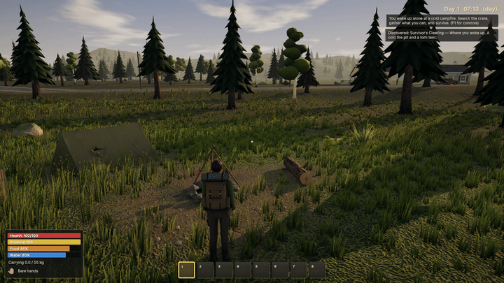
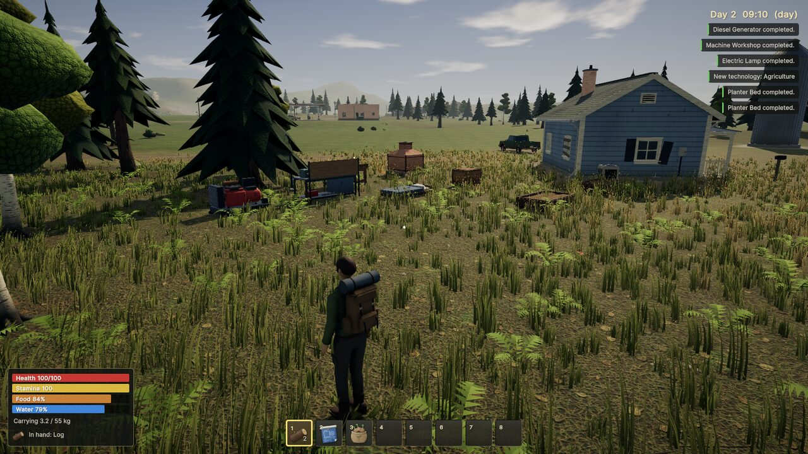
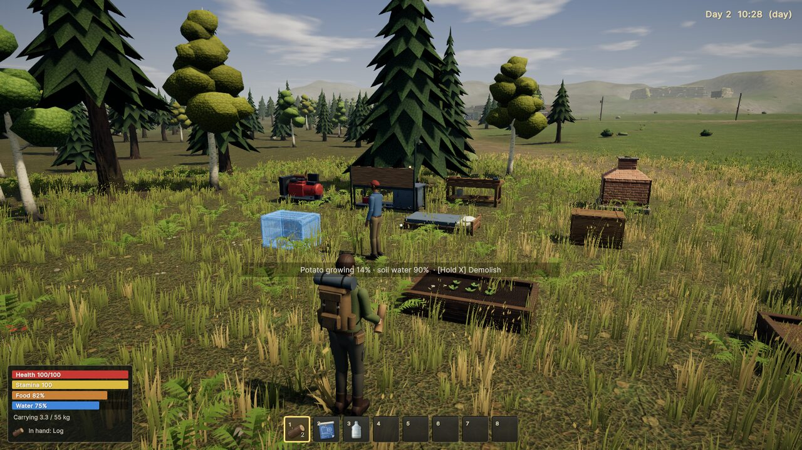
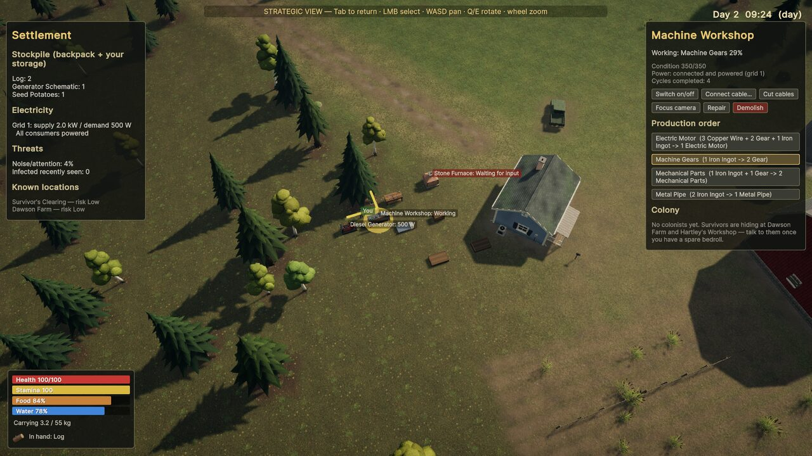
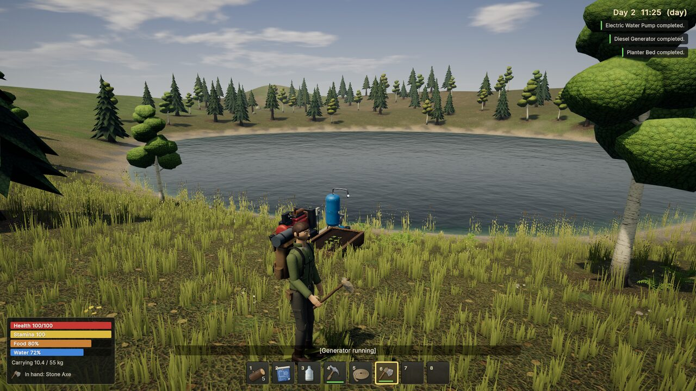
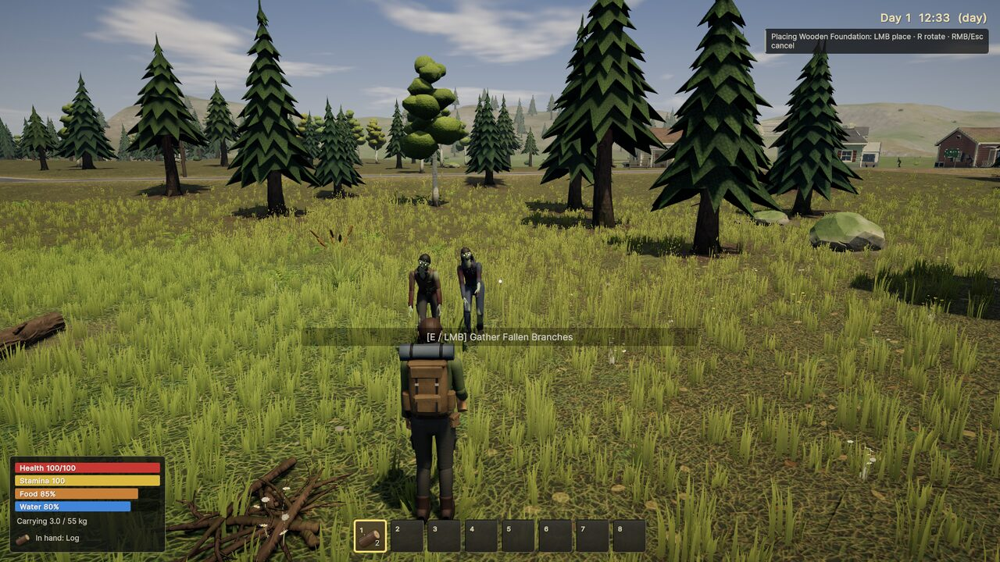
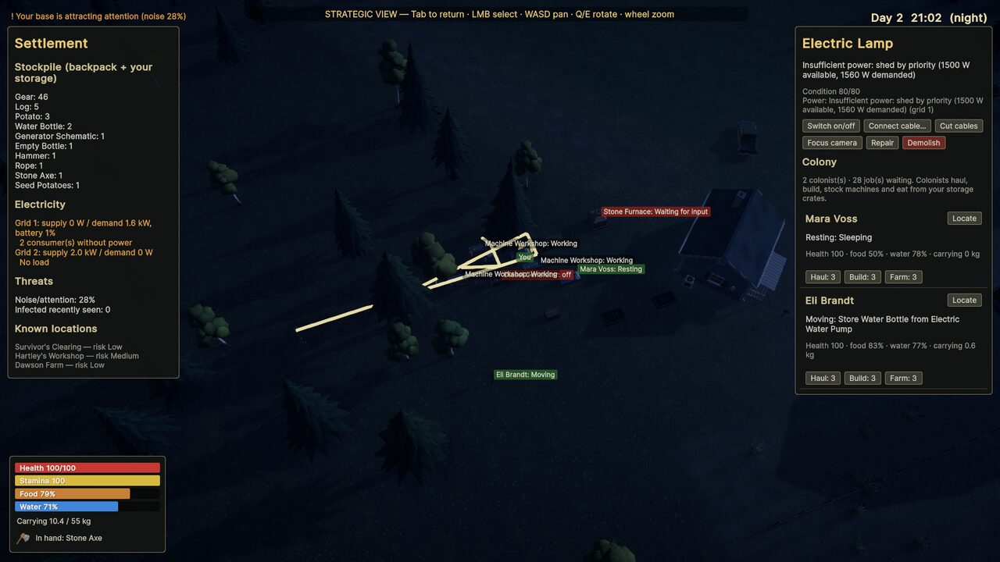
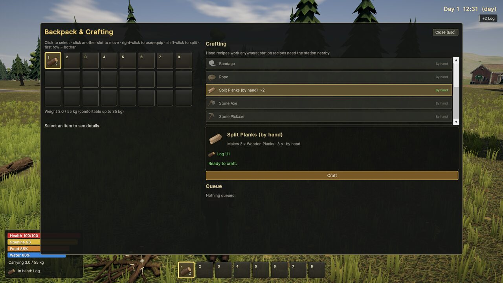
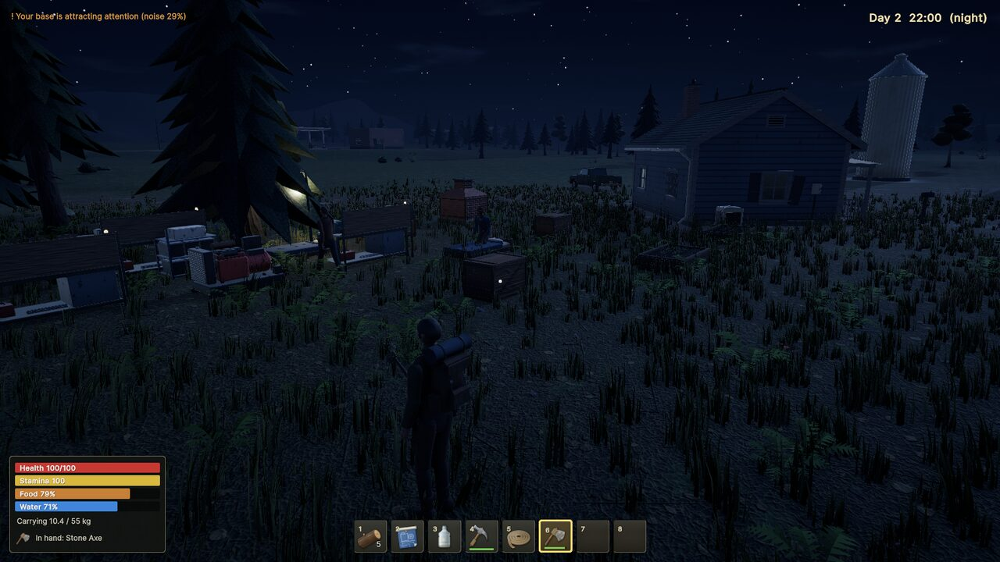
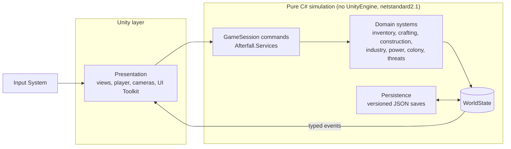

<p align="center">
  
</p>

<h1 align="center">AFTERFALL</h1>

<p align="center"><b>An open-source 3D survival game where you go from scavenging alone in a ruined valley to running a powered, automated settlement with colonists, built in Unity 6 on a deterministic C# simulation.</b></p>

<p align="center">
  <a href="https://github.com/Ale-Newport/AfterFall/actions/workflows/ci.yml"></a>
  <a href="https://github.com/Ale-Newport/AfterFall/actions/workflows/codeql.yml"></a>
  <a href="https://github.com/Ale-Newport/AfterFall/releases/latest"></a>
  <a href="LICENSE"></a>
  
  
  
  <a href="https://github.com/Ale-Newport/AfterFall/discussions"></a>
</p>

<p align="center">
  <a href="https://github.com/Ale-Newport/AfterFall/releases/latest"><b>Download for macOS</b></a> ·
  <a href="#quick-start">Quick start</a> ·
  <a href="#architecture">Architecture</a> ·
  <a href="docs/PROGRESS.md">Progress</a> ·
  <a href="CONTRIBUTING.md">Contributing</a> ·
  <a href="https://github.com/Ale-Newport/AfterFall/discussions">Discussions</a>
</p>

You wake up alone in a quiet, ruined valley. You scavenge, build shelter, smelt metal, bring electricity back and automate production, then recruit survivors who haul, build, farm and defend with you. Everything (inventories, machines, power grids, colonist jobs, infected, saves) runs on one authoritative simulation that works with or without rendering, and 131 tests check it headlessly on Linux, Windows and macOS.

> **Status: early playable prototype, `v0.1.0`.** All 131 EditMode tests and 7 PlayMode tests pass in Unity 6000.3.28f1. The macOS build passes a scripted tour of every system with 0 failed checks and 0 logged errors at about 8.4 ms per frame on an Apple M2 Max. Nobody has played it by hand yet (the tour drives commands, not the mouse and keyboard), the art is procedural, and the Windows build is untested. [docs/PROGRESS.md](docs/PROGRESS.md) lists exactly what is verified. Playtest reports are the most useful contribution right now.

| | |
|---|---|
|  |  |
|  |  |
|  |  |
|  |  |

_Every image is an unedited frame from the scripted tour of the macOS build (`tools/run-unity-checks.sh tour`). The GIF above is assembled from those frames._

## Quick start

**Play** (macOS, Apple silicon or Intel): download `AFTERFALL-<version>-macOS-universal.zip` from the [latest release](https://github.com/Ale-Newport/AfterFall/releases/latest) and unzip it. The build is not notarized, so clear the download quarantine once before opening it:

```bash
xattr -dr com.apple.quarantine ~/Downloads/AFTERFALL.app
```

Then open `AFTERFALL.app`, choose **New Game** and press **F1** in game for help.

**Develop** (needs Git LFS and the .NET 10 SDK; Unity is only needed to run the game): one command clones the project, sets up LFS and the commit hook, and runs the full simulation test suite.

```bash
git clone https://github.com/Ale-Newport/AfterFall.git && cd AfterFall && ./tools/setup-dev.sh && dotnet test tools/dotnet/AfterfallSim.Tests/AfterfallSim.Tests.csproj
```

To play from source, open the folder in Unity Hub with Unity 6000.3.28f1 and press **Play** (details in [Getting started](#getting-started)).

## Architecture



The simulation is deterministic and engine-independent: a furnace keeps smelting whether or not its GameObject exists, and a save contains the world, not the scene. The same sources compile in Unity and in `tools/dotnet`, which is how CI tests them without a Unity license. See [docs/ARCHITECTURE.md](docs/ARCHITECTURE.md) and the [architecture decision records](docs/decisions/).

## Design pillars

1. **Consequential survival.** Scarcity, preparation and danger. Death drops your gear where you fell.
2. **Transformative progression.** Knowledge unlocks new capabilities (furnaces, electricity, pumps), and you unlock it by doing things in the world, not by grinding XP.
3. **Interconnected simulation.** Inventories, machines, power networks, construction, threats and saves all run on one authoritative world state, whether or not anything is rendered.
4. **Accessible strategy.** A strategic camera lets you inspect and direct your settlement. It does not grant omniscience, and it does not teleport materials.

## What is in the prototype

| Area | Implemented |
|---|---|
| World | Deterministic 512 m × 512 m valley: Unity Terrain, lake, northern ridge, roads, forest (~1,000 harvestable trees), 6 points of interest (Millbrook settlement, Route 9 gas station, Hartley's Workshop, Ridge Substation, Old Quarry, Dawson Farm) plus a starting camp |
| Survivor | Third-person movement: walk, run, stamina-limited sprint, crouch, jump. Health, stamina, hunger, thirst, carry weight, death and respawn with recoverable belongings |
| Cameras | Cinemachine 3 shoulder camera with collision and zoom. Tab switches to a strategic view with pan, rotate and zoom |
| Items | 36 items in 8 categories, with stacking, weight limits, durability, filters and a reservation-based transactional inventory |
| Crafting | 20 data-driven recipes: hand crafting, the workbench station, and machine processing |
| Construction | 17 buildable structures. Ghost preview, snapping (foundations, walls, roofs), rotation, explained placement validation, blueprint → delivery → construction work, repair and demolition |
| Industry | Stone furnace (burns fuel), powered machine workshop, electric water pump. Explicit machine states with reasons. Semi-automatic pull/push from adjacent crates |
| Electricity | Generators (fuel cans or charcoal), power poles, lamps and battery banks. Graph networks, priority load shedding, fuel burned in proportion to load |
| Technology | Survival → Agriculture → Metalworking → Electrification → Water Works, unlocked by world activity |
| Threats | Wanderer and Runner infected: vision, hearing and occlusion; investigate, chase, attack and search states; NavMesh movement. They batter walls and barricades that block them, and hunt colonists too. A threat director with fair spawning, night pressure and announced attacks on noisy bases |
| Colony | Two recruitable survivors (each needs a free bedroll). A job board that hauls blueprint materials, builds, stocks machine inputs and fuel, stores products, and refuels generators. Assignment by priority, preference, skill and distance. Reservation-backed hauling that never loses items. Colonists eat, sleep, flee and can die. Strategic colony panel |
| Agriculture | Seed potatoes, planter beds, hand watering or pump irrigation, growth and harvest with seeds returned |
| Audio | Fully procedural soundscape (no third-party audio) with optional captions for important sounds |
| Persistence | Versioned JSON saves with SHA-256 checksums, migrations, validation, atomic writes and automatic backup recovery. Quick save, autosave and save slots |
| UI | UI Toolkit HUD, backpack and crafting, containers, machine and generator panels, construction menu, strategic overview, main and pause menus, settings with key rebinding |

## Industrial progression (the prototype chain)

```
fiber → rope ┐
branches/stone ─┴→ stone axe → logs → workbench → planks → shelter
iron ore (quarry, pickaxe) + workbench ⇒ Metalworking → furnace → iron ingots
generator schematic (Ridge Substation) + 2 ingots ⇒ Electrification
generator (+ fuel cans / charcoal) ⇢ cables ⇢ machine workshop → gears → mechanical parts, pipes, motors
4 gears machined ⇒ Water Works → electric water pump → clean water
```

## Technology stack

- Unity **6000.3.28f1** (6.3 LTS), Universal Render Pipeline 17.3.0
- C# 9: pure .NET Standard 2.1 simulation assemblies plus a Unity presentation assembly
- Input System 1.19.0 (actions defined in code, rebindable), Cinemachine 3.1.7, AI Navigation 2.0.14, UI Toolkit, Newtonsoft JSON 3.2.2
- Unity Test Framework 1.6.0 (EditMode + PlayMode), NUnit
- Git + Git LFS (binary art and audio); GitHub Actions for tests on three operating systems, lint, CodeQL, secret scanning, dependency audits and releases

## Requirements

- Unity Hub with **Unity 6000.3.28f1** (another 6000.3.x patch should also work) and the macOS or Windows build support module
- macOS (Apple silicon or Intel) or Windows 10/11, keyboard and mouse
- Optional, for headless verification: .NET SDK 10, Python 3

## Getting started

```bash
git clone https://github.com/Ale-Newport/AfterFall.git && cd AfterFall && ./tools/setup-dev.sh
```

`setup-dev.sh` enables Git LFS for this repository only and installs the commit-msg hook.

1. Open the folder in Unity Hub (**Add project from disk**) using Unity 6000.3.28f1.
2. On first import, the editor opens `Assets/_Afterfall/Scenes/Main.unity` and validates the content files.
3. Press **Play**, or use **AFTERFALL → Play Main Scene** (⌘⇧P / Ctrl+Shift+P).
4. Choose **New Game**, pick a difficulty and start.

To build a standalone player, use **AFTERFALL → Build → macOS / Windows (64-bit)**, or run:

```bash
"/Applications/Unity/Hub/Editor/6000.3.28f1/Unity.app/Contents/MacOS/Unity" -batchmode -quit -projectPath . -executeMethod Afterfall.EditorTools.BuildCommands.BuildMacOS -logFile -
```

## Controls

| Action | Default |
|---|---|
| Move / sprint / crouch / jump | WASD / Shift / C or Ctrl / Space |
| Look / zoom | Mouse / wheel |
| Interact (hold to build) / demolish your structure | E / hold X |
| Attack or harvest | Left mouse button |
| Hotbar / drop held item | 1–8 / Q |
| Backpack and crafting | I |
| Construction menu / rotate blueprint / cancel | B / R or wheel / right mouse button |
| Strategic view | Tab (WASD pan, Q/E rotate, wheel zoom, left-click select) |
| Quick save / quick load | F5 / F9 |
| Performance overlay / help / menu | F3 / F1 / Esc |

Every binding can be changed in **Settings**.

## Testing

```bash
dotnet test tools/dotnet/AfterfallSim.Tests/AfterfallSim.Tests.csproj
```

This runs the EditMode test suite (131 tests) headlessly, as CI does on Linux, Windows and macOS: inventory conservation, reservations, crafting, construction, machines, power, AI, threats, world generation, saves and colonist jobs, farming and full gameplay-loop scenarios.

With Unity installed and licensed, `tools/run-unity-checks.sh` runs the same suite inside Unity, the PlayMode smoke tests, a macOS build and the scripted tour (screenshots, frame times and an error count in `Logs/unity-checks/`). See [docs/TESTING.md](docs/TESTING.md).

## Documentation

- [docs/GDD.md](docs/GDD.md): implementation-oriented game design
- [docs/ARCHITECTURE.md](docs/ARCHITECTURE.md): modules, dependency rules, simulation flow
- [docs/DEVELOPMENT_ROADMAP.md](docs/DEVELOPMENT_ROADMAP.md): phases and acceptance criteria
- [docs/PROGRESS.md](docs/PROGRESS.md): what is done, verified, partial or missing
- [docs/TESTING.md](docs/TESTING.md) and [docs/CONTENT_PIPELINE.md](docs/CONTENT_PIPELINE.md)
- [docs/decisions/](docs/decisions/): architecture decision records
- [docs/ASSET_LICENSES.md](docs/ASSET_LICENSES.md) and [CHANGELOG.md](CHANGELOG.md)

## Contributing

Contributions are welcome through forks and pull requests; every pull request is reviewed and approved by the maintainer before it merges. Start with [CONTRIBUTING.md](CONTRIBUTING.md), pick a [`good first issue`](https://github.com/Ale-Newport/AfterFall/labels/good%20first%20issue) or [`help wanted`](https://github.com/Ale-Newport/AfterFall/labels/help%20wanted) issue, or share a playtest in [Discussions](https://github.com/Ale-Newport/AfterFall/discussions). Please follow the [Code of Conduct](CODE_OF_CONDUCT.md), and report vulnerabilities privately as described in [SECURITY.md](SECURITY.md).

## License

AFTERFALL is released under the [MIT License](LICENSE). Files derived from Unity's 3D (URP) template (project settings, URP pipeline assets and the URP-derived base materials) remain under the [Unity Companion License](https://unity.com/legal/licenses/unity-companion-license); see [NOTICE](NOTICE) and [docs/ASSET_LICENSES.md](docs/ASSET_LICENSES.md).
